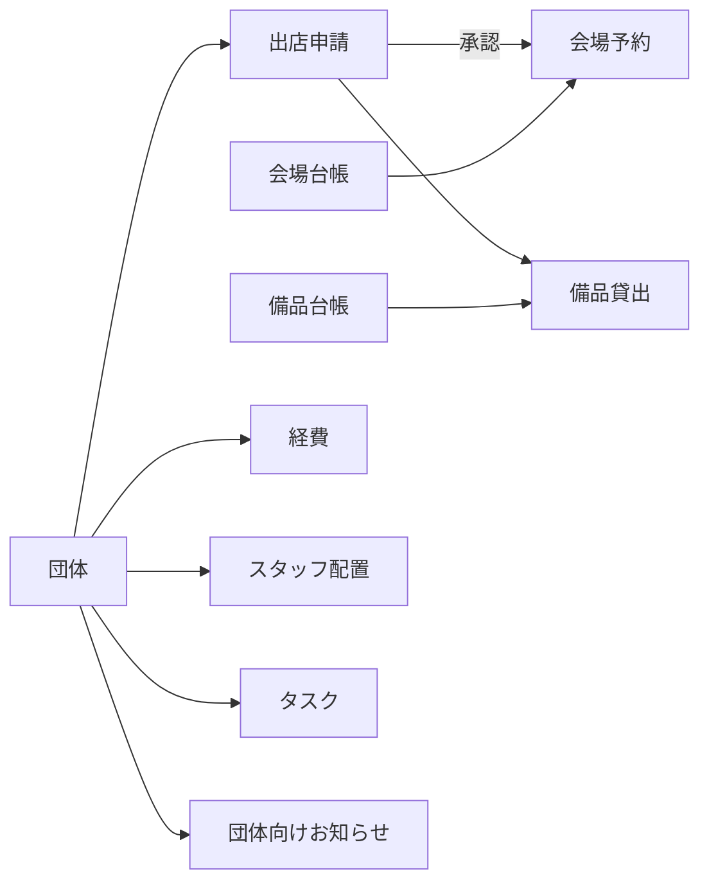

# 業務とデータの見取り図

## 業務の基本

団体が出店を申請し、実行委員が承認すると、関連する会場予約が作成されます。備品は申請・団体へ関連付けて貸し出します。経費は団体ごとの予算に対して記録します。スタッフ配置とタスクも団体へ関連付けます。

## コレクション

| 名前         | ID接頭辞 | 主な参照・用途                                             |
| ------------ | -------- | ---------------------------------------------------------- |
| groups       | G        | name, representative, members, budget                      |
| applications | A        | groupId, venueId, date, start, end, attendees, status      |
| reservations | R        | applicationId, groupId, venueId, date, start, end, status  |
| equipment    | E        | name, stock（所有する総数）                                |
| loans        | L        | equipmentId, groupId, applicationId, quantity, due, status |
| expenses     | X        | groupId, amount（小数を保持）, category, date, status       |
| shifts       | S        | name, groupId, date, start, end, location                  |
| tasks        | T        | groupId, owner, due, status                                |
| notices      | N        | groupId（allは全体）, date, body                           |
| venues       | V        | name, capacity                                             |
| activity     | なし     | at, message。直近100件                                     |

`version`は保存形式、`role`と`groupId`は操作中の役割と団体です。日付はYYYY-MM-DD、時刻はHH:mm、同日内の利用を基本とします。初期シナリオは2026年11月14・15日の開催です。期限表示の基準日は端末のローカル日付です。

各一覧の日付・期限には、日付に加えて曜日を表示します。

JSONバックアップの復元前に、形式、必須コレクション・項目、値の型、状態名、IDの重複を検証します。復元データを保存できた場合にだけ画面の状態を置き換えます。検証や保存に失敗した場合、現在のデータと表示中の画面は維持されます。

## 団体の削除と履歴

団体一覧で「履歴へ」を選ぶと、団体データは削除せず`archivedAt`を記録して一覧から外します。団体一覧の「削除済みの履歴」から内容を確認でき、必要なら復元できます。申請・会場予約・貸出・経費などの`groupId`は維持され、申請や経費の一覧には元の団体名と「削除済み」が表示されます。新規データの団体選択肢には削除済み団体を出さず、既存データの編集時には関連付けを維持するために選択肢へ含めます

## 状態

- 申請：draft（下書き）、submitted（承認待ち）、approved（承認済み）、rejected（差し戻し）、cancelled（取消）。
- 会場予約：approved、cancelled。
- 貸出：reserved（予約）、active（貸出中）、returned（返却済み）。
- 経費：submitted、approved、rejected。
- タスク：todo、active、done。

出店申請を承認できるのは実行委員（admin）のみです。団体代表（leader）と一般スタッフ（staff）は承認できません。これはブラウザー内の演習用チェックであり、本物の認証・アクセス制御ではありません。

承認済みの出店申請で、会場予約に反映される重要項目（団体・会場・開催日・開始/終了時刻・参加予定人数）を変更すると、申請はsubmittedに戻り`reapprovalPending: true`が付きます。関連する会場予約は再承認までcancelledになり、実行委員が一覧の「承認」ボタンで再承認すると、既存の予約が申請内容で更新されて承認済みに戻ります（予約は重複作成しません）。承認はフォームの状態欄からは行えません。申請に紐づく会場予約は、承認済みの申請と同じ内容でなければ有効（approved）にできません。承認済み・再承認待ちの申請を変更した内容は、変更前後の値を`changeHistory`（日時・役割・種別・項目ごとの変更前後）に記録し、申請の編集画面で確認できます。

出店申請の差し戻しは、実行委員が一覧の「差し戻し」ボタンから承認待ち（submitted）の申請に対して行い、理由の入力を必須とします（フォームの状態欄からは差し戻せません）。理由は申請の`rejectReason`に保存して一覧と編集画面に表示し、`changeHistory`にも種別rejected・理由付きで記録するため、再提出後も過去の差し戻し理由を確認できます。

経費合計と団体別の予算残額には、承認済み（approved）の経費のみを含めます。承認待ち（submitted）と差し戻し（rejected）は含めません。

備品の`stock`は所有総数で、貸出の返却操作では変更しません。貸出可能数は所有総数から予約（reserved）と貸出中（active）の数量を差し引きます。備品・貸出画面では対象日（初期値は当日）を選べ、返却期限が対象日より前の予約はその日の計算から除きます。貸出中は返却されるまで常に差し引きます。予約・貸出の登録時は、返却期限の日を対象日として、編集中の貸出自身を除いた貸出可能数を超える数量を登録できません。返却は貸出状態をreturnedに一度だけ変更し、返却済みレコードへの再操作では在庫数に影響しません。

これらは既存実装の状態名です。業務として正しく動くかは報告を調べて判断してください。状態や項目を追加するときは、既存データ、一覧、集計、バックアップを一緒に確認します

## 変更時の確認

1. domain.jsの関数とapp.jsの呼び出し元を探す。
2. 正常・境界・不正な値で確認する。
3. 関連する別画面と集計を見る。
4. 保存後の再読み込み、JSON書き出し・復元も確認する。
5. 検証手順と結果をPRへ記録する。

共通ルールの変更は複数Issueに影響します。先にチーム内で担当と変更範囲を相談してください。