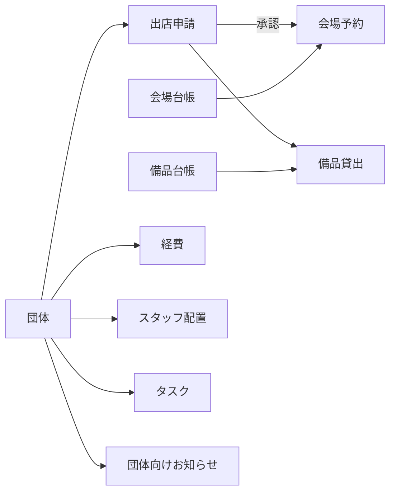

# 業務とデータの見取り図

## 業務の基本

団体が出店を申請し、実行委員が承認すると、関連する会場予約が作成されます。備品は申請・団体へ関連付けて貸し出します。経費は団体ごとの予算に対して記録します。スタッフ配置とタスクも団体へ関連付けます。

## コレクション

| 名前         | ID接頭辞 | 主な参照・用途                                             |
| ------------ | -------- | ---------------------------------------------------------- |
| groups       | G        | name, representative, members, budget                      |
| applications | A        | groupId, venueId, date, start, end, attendees, status      |
| reservations | R        | applicationId, groupId, venueId, date, start, end, status  |
| equipment    | E        | name, stock（所有する総数）                                |
| loans        | L        | equipmentId, groupId, applicationId, quantity, due, status |
| expenses     | X        | groupId, amount, category, date, status                    |
| shifts       | S        | name, groupId, date, start, end, location                  |
| tasks        | T        | groupId, owner, due, status                                |
| notices      | N        | groupId（allは全体）, date, body                           |
| venues       | V        | name, capacity                                             |
| activity     | なし     | at, message。直近100件                                     |

`version`は保存形式、`role`と`groupId`は操作中の役割と団体です。日付はYYYY-MM-DD、時刻はHH:mm、同日内の利用を基本とします。初期シナリオは2026年11月14・15日の開催です。期限表示の基準日は端末のローカル日付です。

団体ごとの予算残額は、経費レコードの`groupId`が一致する金額だけを予算から差し引きます。既存の経費レコードも、それぞれに保存された`groupId`に基づいて集計します。`groupId`を指定した経費集計は、その団体だけを対象にします。全団体の合計を表示する場合は、全体集計を明示して団体別集計と区別します。

承認済み申請の企画名、団体、会場、開催日・時間、参加人数を変更すると、変更案は保留されて再承認待ちになります。承認されるまでは申請と会場予約の確定済み情報を維持し、変更案の承認時に申請・予約を同時に更新します。重要項目の変更履歴は申請一覧で確認できます。

## 状態

- 申請：draft（下書き）、submitted（承認待ち）、approved（承認済み）、rejected（差し戻し）、cancelled（取消）。
- 会場予約：approved、cancelled。
- 貸出：reserved（予約）、active（貸出中）、returned（返却済み）。
- 経費：submitted、approved、rejected。
- タスク：todo、active、done。

これらは既存実装の状態名です。業務として正しく動くかは報告を調べて判断してください。状態や項目を追加するときは、既存データ、一覧、集計、バックアップを一緒に確認します。

## 変更時の確認

1. domain.jsの関数とapp.jsの呼び出し元を探す。
2. 正常・境界・不正な値で確認する。
3. 関連する別画面と集計を見る。
4. 保存後の再読み込み、JSON書き出し・復元も確認する。
5. 検証手順と結果をPRへ記録する。

共通ルールの変更は複数Issueに影響します。先にチーム内で担当と変更範囲を相談してください。
